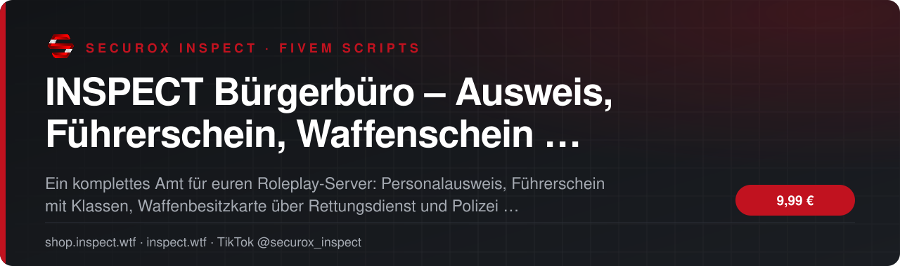
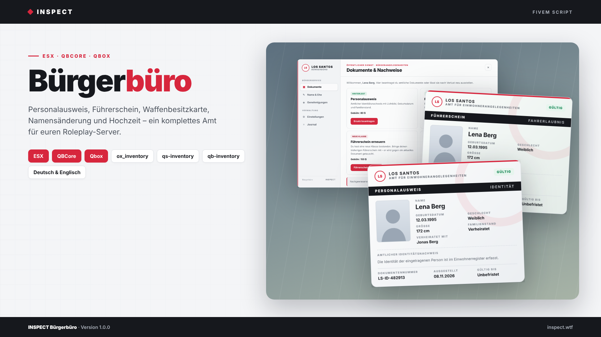
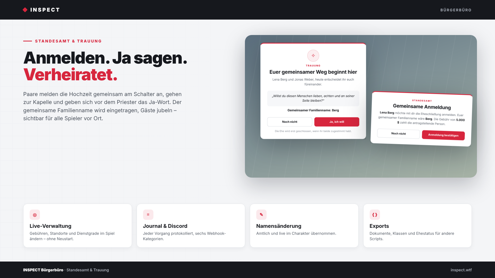
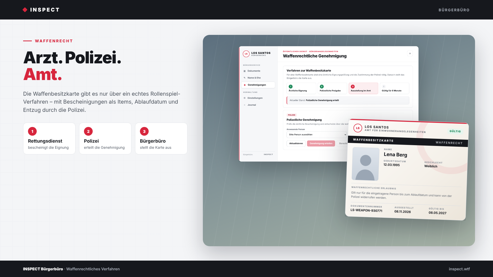

<!-- inspect-showcase: automatisch erzeugt, Änderungen bitte im Shop vornehmen -->

  
  
  
  
  

  
  
  

 

> 🇬🇧 **English:** INSPECT Bürgerbüro – Ausweis, Führerschein, Waffenschein & Hochzeit für FiveM – FiveM script (ESX, QBCore, Qbox) by SecuroX Inspect. Purchase and licensing exclusively at [shop.inspect.wtf](https://shop.inspect.wtf). Product details below are in German – questions are welcome on [Discord](https://discord.gg/inspect).

 

## Das Wichtigste auf einen Blick

<table>
  <tr>
    <td width="50%" valign="top">✔&nbsp; <b>Kompatibilität · ESX Legacy, QBCore und Qbox mit automatischer Framework-Erkennung</b></td>
    <td width="50%" valign="top">✔&nbsp; <b>Kompatibilität · Inventare: ox_inventory, qs-inventory, qb-inventory, ps-inventory, lj-inventory, jaksam_inventory und Framework-Standard – automatisch erkannt</b></td>
  </tr>
  <tr>
    <td width="50%" valign="top">✔&nbsp; <b>Kompatibilität · Datenbank über oxmysql, Tabellen werden beim ersten Start automatisch angelegt</b></td>
    <td width="50%" valign="top">✔&nbsp; <b>Kompatibilität · ox_lib nicht erforderlich – eigene Benachrichtigungen und Hinweise, optional ox_lib, ESX, QBCore oder GTA-Standard</b></td>
  </tr>
</table>

## Überblick

Ein Bürgerbüro, das Rollenspiel erzeugt.

In vielen Servern ist ein Ausweis nur ein Item, das man irgendwo kauft. INSPECT Bürgerbüro macht daraus echte Behördengänge: Spieler sprechen mit der Sachbearbeiterin, beantragen ihre Dokumente am Schalter und bezahlen die Gebühr. Jedes Dokument öffnet sich als hochwertige Ausweiskarte mit Lichtbild des Charakters, Geburtsdatum, Geschlecht, Familienstand und Dokumentennummer – und kann per Tastendruck einer Person in der Nähe vorgezeigt werden.

Führerschein mit Klassen  
Der Führerschein zeigt alle bestandenen Klassen von A bis D. Die Klassen kommen direkt aus euren Fahrschul-Lizenzen (ESX user_licenses bzw. QBCore-Metadaten). Hat ein Spieler eine neue Klasse bestanden, tauscht er seinen alten Führerschein im Amt gegen einen aktuellen.

Waffenschein als echtes Verfahren  
Die Waffenbesitzkarte gibt es nicht einfach zu kaufen. Zuerst bescheinigt der Rettungsdienst die Eignung, dann erteilt die Polizei die Genehmigung, erst danach stellt das Bürgerbüro die Karte aus. Die Bescheinigungen sind Items, die Karte ist zeitlich befristet und kann von der Polizei jederzeit entzogen werden – inklusive automatischem Entzug der Waffenlizenz.

Standesamt und Trauung  
Paare melden ihre Hochzeit gemeinsam am Schalter an und wählen einen gemeinsamen Familiennamen. In der Kapelle erscheint ein Priester, beide geben ihr Ja-Wort, der Name wird eingetragen und Hochzeitsgäste jubeln. Priester und Gäste sind OneSync-Peds und für alle Spieler vor Ort sichtbar. Die Ehe steht danach auf dem Personalausweis.

Alles live im Spiel verwalten  
Im Verwaltungsbereich ändert ihr Gebühren, setzt Bürgerbüro und Kapelle per Knopfdruck an eure Position und legt die Mindest-Dienstgrade für Polizei und Rettungsdienst fest – ohne Neustart. Ein Verwaltungsjournal und Discord-Webhooks in sechs Kategorien protokollieren jeden Vorgang.

Serverseitig abgesichert  
Personendaten, Gebühren, Items und Genehmigungen werden ausschließlich auf dem Server geprüft: Standort, Entfernung, Dienstgrad, Kontostand und Inventar. Schlägt eine Ausgabe fehl, wird die Gebühr automatisch erstattet.

Schnell installiert  
Framework und Inventar werden automatisch erkannt, alle Tabellen legt das Script beim ersten Start selbst an. Item-Vorlagen für ox_inventory, QBCore und ESX liegen bei, ebenso eine Anleitung auf Deutsch und Englisch.

## Kompatibilität

| | |
|:--|:--|
| Frameworks | **ESX** · **QBCore** · **Qbox** |
| Unterstützte Ressourcen | `ox_inventory` |
| Plattform | FiveM (GTA V) |

## Alle weiteren Funktionen

- Bürgerbüro · Sachbearbeiterin als NPC mit Blip, Interaktion per E-Taste
- Dokumente · Personalausweis, Führerschein und Waffenbesitzkarte als Inventar-Items
- Dokumente · Ausweiskarte mit Live-Lichtbild des Charakters, Geburtsdatum, Geschlecht, Größe und Dokumentennummer
- Dokumente · Per Taste einer Person in der Nähe vorzeigen, Gültigkeitsstatus direkt auf der Karte
- Dokumente · Ersatz nur nach Verlust, keine doppelte Ausstellung
- Führerschein · Klassen A, B, C, CE und D aus euren Fahrschul-Lizenzen, Zuordnung frei konfigurierbar
- Führerschein · Erneuerung nach bestandener neuer Klasse gegen Abgabe des alten Führerscheins
- Waffenschein · Verfahren über Rettungsdienst, Polizei und Bürgerbüro mit Bescheinigungen als Items
- Waffenschein · Befristete Gültigkeit, Entzug durch die Polizei inklusive Waffenlizenz
- Waffenschein · Fortschrittsanzeige des Verfahrens für Spieler

<b>21 weitere Funktionen anzeigen</b>

- Namensänderung · Vor- und Nachname amtlich ändern, sofort im Charakter übernommen
- Hochzeit · Gemeinsame Anmeldung am Schalter mit Wahl des Familiennamens und Bestätigung durch die Partnerperson
- Hochzeit · Trauung in der Kapelle mit Priester, Ja-Wort beider Personen und jubelnden Gästen
- Hochzeit · Priester und Gäste als OneSync-Peds für alle Spieler sichtbar, feste Gastplätze optional
- Hochzeit · Familienstand und Ehepartner auf dem Personalausweis
- Verwaltung · Gebühren, Standorte und Mindest-Dienstgrade live im Spiel ändern – ohne Neustart
- Verwaltung · Bürgerbüro und Kapelle per Knopfdruck an der eigenen Position setzen
- Verwaltung · Fernzugriff für Admins, Polizei und Rettungsdienst
- Protokoll · Verwaltungsjournal im Spiel mit den letzten 50 Vorgängen
- Protokoll · Discord-Webhooks in sechs Kategorien, Test-Befehl über die Serverkonsole
- Sicherheit · Alle Vorgänge serverseitig geprüft: Standort, Entfernung, Dienstgrad, Kontostand und Inventar
- Sicherheit · Automatische Erstattung bei fehlgeschlagener Ausgabe, Schutz gegen Doppelbuchungen und zu schnelle Anfragen
- Design · Helles, klares Interface mit frei wählbarer Akzentfarbe und eigenem Behördennamen
- Sprache · Deutsch und Englisch, weitere Sprachen einfach ergänzbar
- Entwickler · Exports für gültige Dokumente, Führerscheinklassen, Ehestatus und Entzug der Waffenbesitzkarte
- Entwickler · Hook für eigene Banking-Scripts und Kontoauszüge
- Entwickler · Config, Bridges, Sprachdateien und Server-Config offen editierbar
- Rechte · ACE-Recht inspect.citizenoffice.admin, zusätzliche Framework-Gruppen konfigurierbar
- Installation · Item-Vorlagen für ox_inventory, QBCore und ESX sowie SQL-Sicherung enthalten
- Installation · Anleitung auf Deutsch und Englisch als README
- Voraussetzungen · OneSync und oxmysql

## Einblicke

<table>
  <tr>
    <td width="50%"></td>
    <td width="50%"></td>
  </tr>
</table>

## Preis

**9,99 €** &nbsp;–&nbsp; einmaliger Kaufpreis · Download und Lizenz im Kundenkonto

Sichere Zahlung mit PayPal oder Kreditkarte · Rechnung als PDF · Support auf Deutsch

## So einfach geht's

1. **Im Shop kaufen** – sicher bezahlen mit PayPal oder Kreditkarte.
2. **Sofort loslegen** – Download und Lizenz stehen direkt nach Zahlungseingang in deinem Kundenkonto bereit, die Rechnung erhältst du als PDF.
3. **Einrichten** – bei Fragen hilft dir unser Support im Discord weiter.

## Warum INSPECT?

<table>
  <tr>
    <td width="50%" valign="top"><b>🇩🇪 Entwickelt in Deutschland</b> Konzeption, Entwicklung und Support aus einer Hand.</td>
    <td width="50%" valign="top"><b>💬 Persönlicher Support</b> Schnelle Hilfe auf Deutsch im INSPECT Discord.</td>
  </tr>
  <tr>
    <td width="50%" valign="top"><b>🔒 Sichere Zahlung</b> PayPal oder Kreditkarte, Rechnung automatisch als PDF.</td>
    <td width="50%" valign="top"><b>⚡ Sofort verfügbar</b> Download und Lizenz direkt nach der Zahlung im Kundenkonto.</td>
  </tr>
</table>

## Häufige Fragen

<b>Wie erhalte ich das Produkt?</b>

 

Nach bestätigter Zahlung stehen Download und Lizenz in deinem Kundenkonto bereit. Die Rechnung erhältst du als PDF.

<b>Welche Frameworks werden unterstützt?</b>

 

ESX, QBCore, Qbox – zusätzlich mit Unterstützung für ox_inventory.

<b>Bekomme ich Hilfe bei der Einrichtung?</b>

 

Ja – unser Support hilft dir im [INSPECT Discord](https://discord.gg/inspect) persönlich und auf Deutsch.

<b>Wo kaufe ich offiziell?</b>

 

Ausschließlich im INSPECT Shop unter [shop.inspect.wtf](https://shop.inspect.wtf). Angebote von Dritten stammen nicht von uns.

## Kontakt

| | |
|:--|:--|
| 🛒 Shop | [shop.inspect.wtf](https://shop.inspect.wtf) |
| 🌐 Website | [inspect.wtf](https://inspect.wtf) |
| 💬 Discord | [discord.gg/inspect](https://discord.gg/inspect) |
| 🎬 TikTok | [@securox_inspect](https://www.tiktok.com/@securox_inspect) |
| ✉️ E-Mail | [info@inspect.wtf](mailto:info@inspect.wtf) |

---

<b>SecuroX Inspect</b> · Offizielle Produktpräsentation · Dieses Repository enthält keinen Quellcode und keine Produktdateien. 
Kauf und Lizenzen ausschließlich über <a href="https://shop.inspect.wtf">shop.inspect.wtf</a> · Inhalte werden automatisch aus dem Shop aktualisiert.

